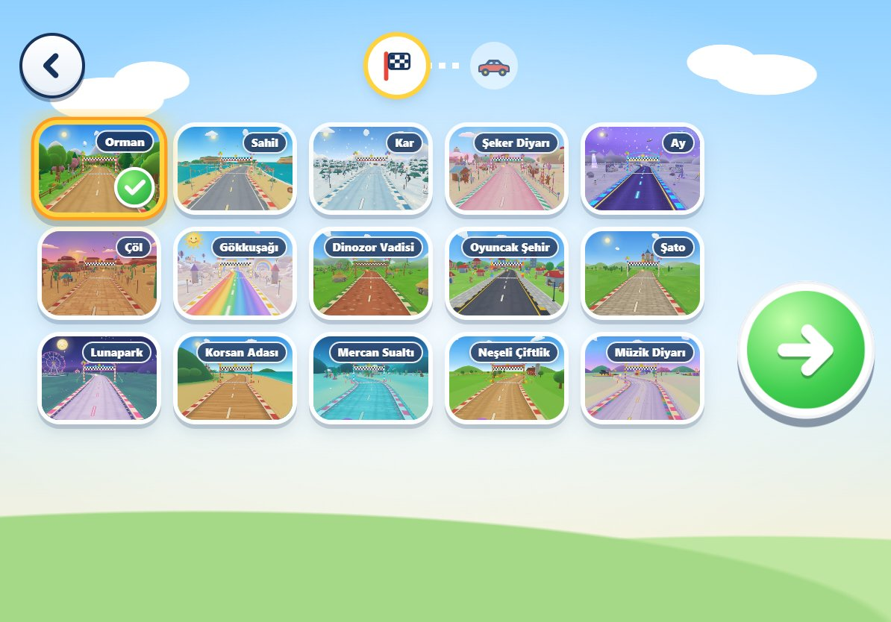
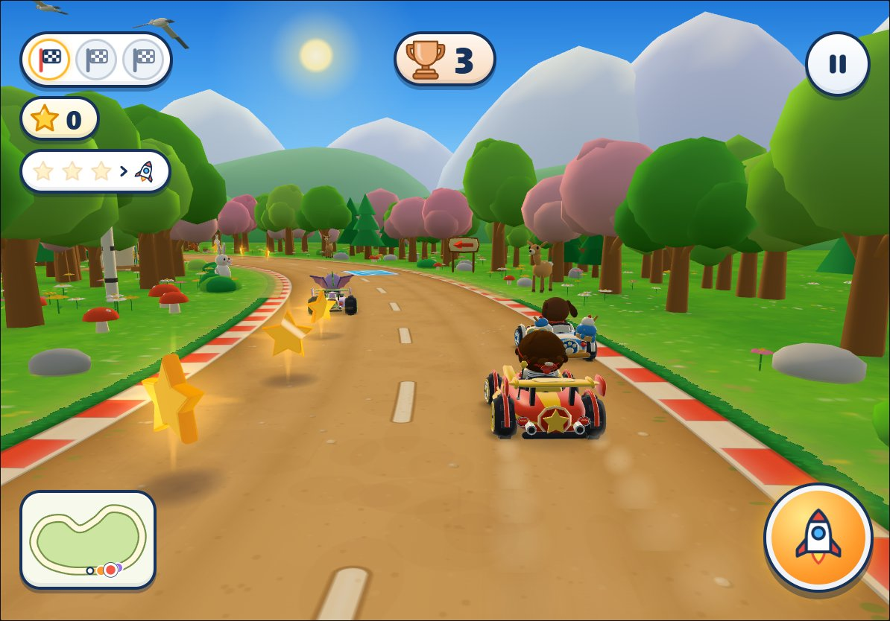
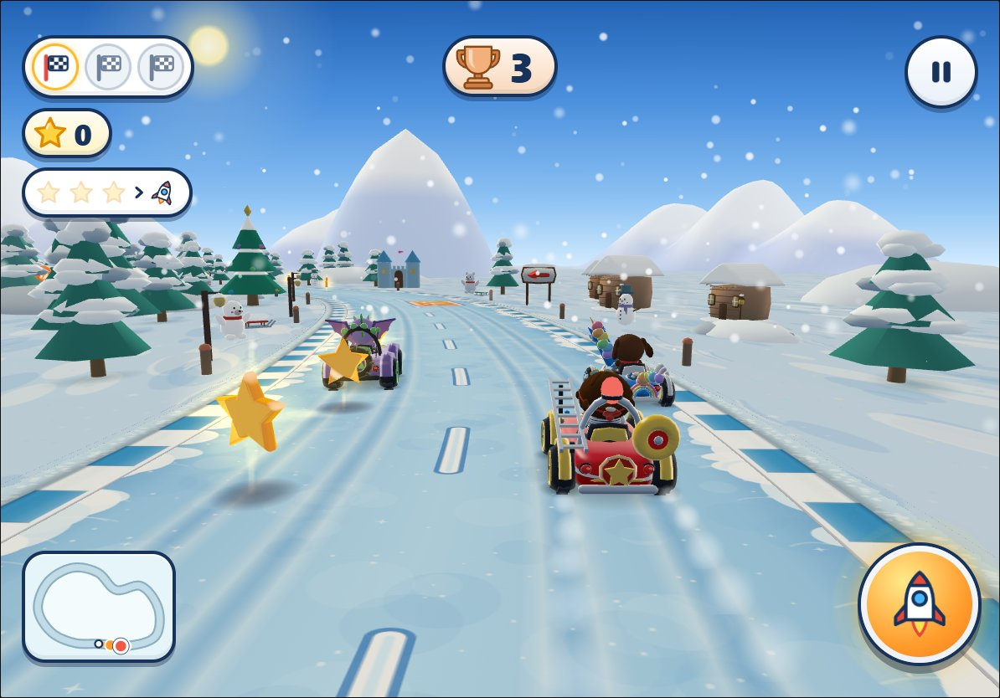
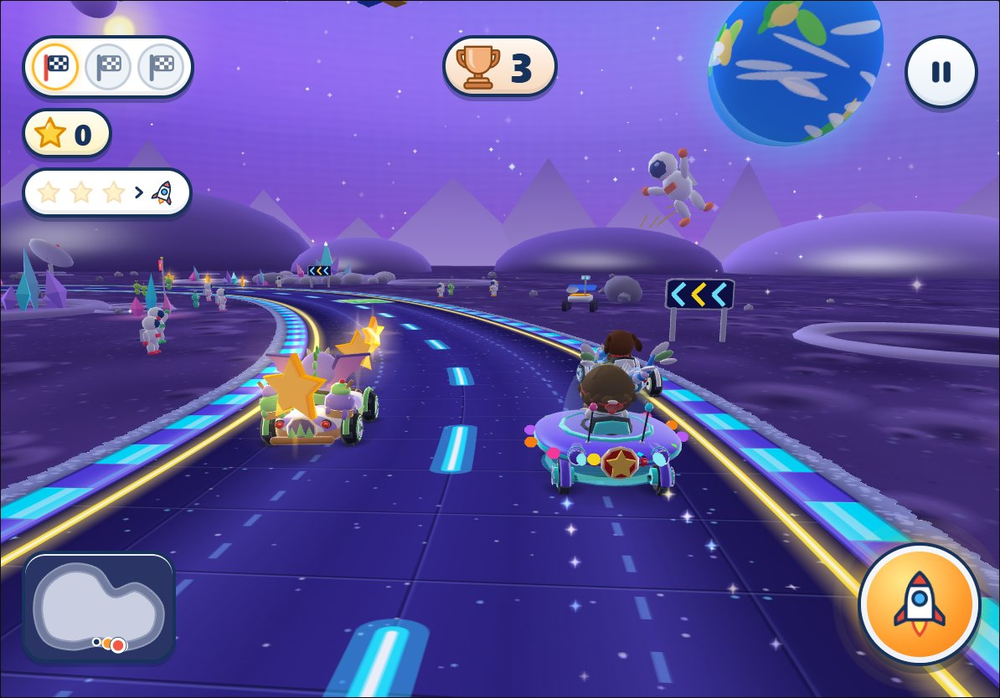
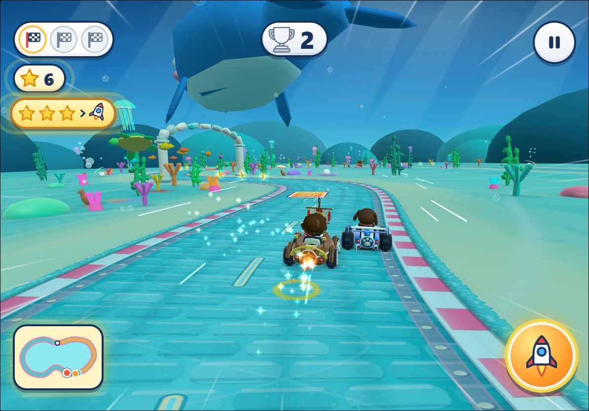
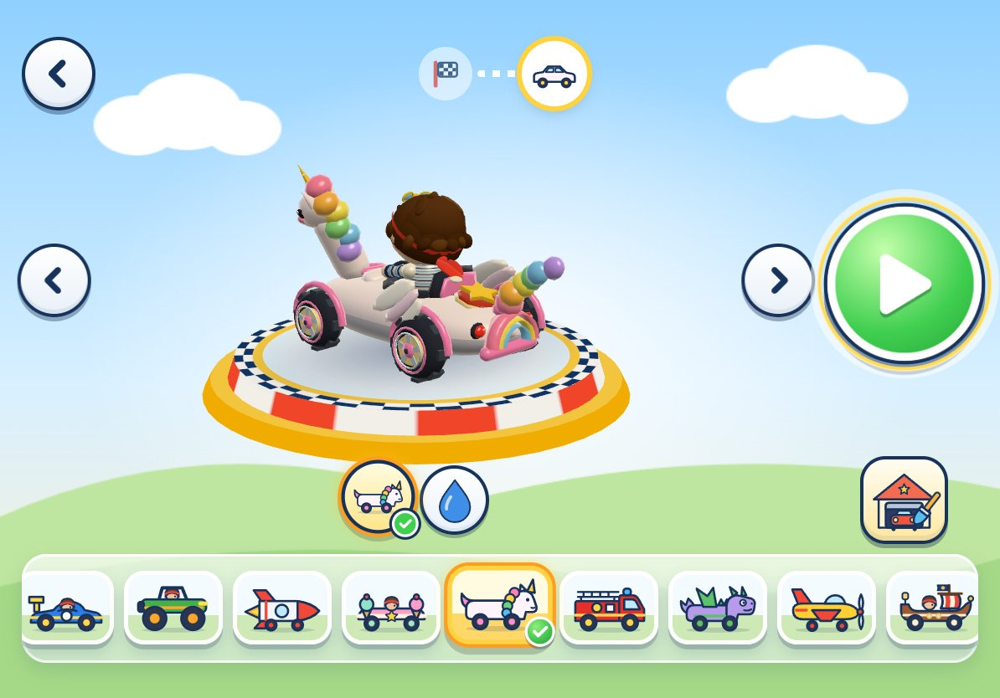

# Feza'nın Yarışı 🏎️⭐

5 yaşındaki Feza için yapılmış, çizgi film tarzında üç boyutlu bir araba yarışı. Feza; peluş ejderhası Pırıl, köpeği Bilbo, annesi ve babasıyla
on beş farklı pistte üçer tur yarışır. Kaybetmek yoktur: Feza her yarışı ilk üçte bitirir. Feza okuma bilmediği için her şey resimlerle,
simgelerle ve anlatıcının sesiyle anlatılır.

**Oyna:** https://goktugkarpat.github.io/feza-yaris/

## Pistler

1. **Orman Yolu** — Yuvarlak ağaçlar, ahşap köprü, dere. Yarışın ortasında hafif bir yağmur yağar; sonra güneş açar ve gökkuşağı çıkar.
2. **Deniz Kıyısı** — Kumsal, palmiyeler, yelkenliler, deniz feneri.
3. **Karlı Dağlar** — Kar yağar; çamlar, dağ evleri ve buz mavisi bir yol.
4. **Şeker Diyarı** — Lolipoplar, kurabiye evler ve tepede bir şeker şato.
5. **Ay Yolu** — Kristaller, el sallayan uzaylılar, ay üssü ve gökte halkalı bir gezegen.
6. **Sıcak Çöl** — Gün batımı, piramitler, kaktüsler ve develer.
7. **Gökkuşağı Yolu** — Bulutların üstünde gökkuşağı renkli bir yol; yumuşak, yavaşça dalgalanan gökkuşakları.
8. **Dinozor Vadisi** — Sevimli dinozorlar, yumurtadan çıkan yavrular, taş kemerler ve gülen bir yanardağ.
9. **Neşeli Şehir** — Renkli oyuncak evler, tahta küpler ve dev bir oyuncak ayı.
10. **Şato ve Ejderha Vadisi** — Yeşil tepelerde kuleli bir şato, bayraklar ve sevimli ejderhalar.
11. **Gece Lunaparkı** — Yıldızlı bir gecede ışıl ışıl dönme dolap ve renkli lunapark ışıkları.
12. **Korsan Adası** — Turkuaz deniz, palmiyeli ada, hazine sandıkları ve korsan gemileri.
13. **Mercan Sualtı** — Mercan sarayı, başımızın üstünde süzülen gülen balina ve yavrusu, balık sürüleri ve kaplumbağalar.
14. **Neşeli Çiftlik** — Kırmızı ahır, dönen yel değirmeni, buğday tarlaları, gölette ördekler; inekler, koyunlar ve tavuklar.
15. **Müzik Diyarı** — Dev piyano sahnesi, gökkuşağı ksilofon kemerleri, titreşen davullar ve havada süzülen notalar.

| | |
|---|---|
|  |  |
|  |  |

## Arabalar ve garaj

On beş araba seçilebilir: kart, yarış arabası, cip, roket, dondurma arabası, tek boynuzlu at, itfaiye, ejderha, uçak, korsan gemisi,
polis arabası, kedi araba, tren, traktör ve uçan daire. Seçim ekranında araba bir platformun üstünde döner; Feza içinde oturur.

Dönen arabanın altında Feza'nın açtığı **renk damlaları** durur: birine dokununca araba hemen boyanır. **Süsle** düğmesi diğer süsleri açar.
Yedi çeşit süs vardır (toplam 43): boya, teker, bayrak, arabanın bıraktığı iz (gökkuşağı, yıldız, baloncuk, kalp), korna sesi (ördek, tren, zil, fil …),
Feza'nın **şapkası** (taç, büyücü şapkası, kask, korsan şapkası, kedi kulaklı bere, çiçek tacı) ve arabanın **kostümü** (ayıcık kulakları,
kocaman gözler ve gülüş, tek boynuz, çiçek çelengi, melek kanatları). Her araba kendi rengini ve süslerini hatırlar; şapka her arabada aynı kalır.

Her yarışta toplanan yıldızlar bitişte **yıldız kavanozuna** uçar. Kavanoz dolunca bir **hediye kutusu** çıkar; kutuya dokununca yeni süs
büyükçe görünür, sonra arabaya ya da Feza'nın başına takılır. Bütün süsler açılınca kavanoz dolu kalır.

## Sürpriz balonlar

Her turda pistte üç renkli balon vardır. Balonun içinden geçince birkaç saniyelik eğlenceli bir güç gelir:

- **Turbo** — araba hızlanır, arkasında altın halkalar bırakır.
- **Kanat** — arabaya kanat çıkar; yolun kenarında da yavaşlamadan süzülür.
- **Gökkuşağı** — araba arkasında parlak bir gökkuşağı şeridi bırakarak hızlanır.
- **Mıknatıs** — yolun her yanındaki yakın yıldızlar kendiliğinden arabaya gelir.

Gücün ne kadar kaldığı ekranın üstünde küçülen renkli bir halkayla gösterilir.

## Nasıl açılır

- **İnternette:** https://goktugkarpat.github.io/feza-yaris/
- **iPad'de uygulama gibi:** Safari'de aç › Paylaş › **Ana Ekrana Ekle**. İlk açılıştan sonra internetsiz de çalışır.
- **Bilgisayarda:** klasördeki `index.html` dosyasına çift tıkla. Kurulum gerekmez.
- **Sessiz açma:** adresin sonuna `?sessiz` ekle.

## Nasıl oynanır

1. Açılışta büyük yeşil ▶ düğmesine dokun.
2. Bir **yarış yeri** seç (on beş resimli kart), sonra bir **araba** seç ve ▶ ile yarışı başlat.
3. Parmağını sağa sola sürükle; araba oraya gider. Gaz ve fren yoktur, araba kendisi ilerler.
4. Turuncu **roket** düğmesi kısa süre hızlandırır.
5. Yıldızları topla: her üç yıldızda kısa bir roket ödülü gelir. Kaçan yıldız seriyi bozmaz.
6. Yoldaki rampalardan zıpla, sürpriz balonların içinden geç.

Her pistin ilk yarışında kamera önce pistin üstünden kısa bir tanıtım uçuşu yapar (dokununca biter). Feza yaklaşınca pistin sakinleri
tepki verir: dinozor yavruları başını çevirir, balina yüzgeç sallar, ördekler havalanır, Pırıl sevinçle zıplar.

Ekranda sıra (kupa), tur (bayraklar), yıldız sayısı ve küçük bir harita görünür. Bitişte Feza kollarını kaldırıp sevinir, birinciyse altın kupayı
kaldırır; ardından sıralama, yıldız kavanozu ve (doluysa) hediye kutusu gelir. Her pist için en iyi yıldız sayısı ve derece (kartta kupa) hatırlanır.
Klavyede ok tuşları ya da A/D ile de sürülebilir.

## Ebeveyn için notlar

- Süre baskısı, kaybetme ya da ceza yoktur; pistten çıkılamaz, ters gidilemez.
- Ekranda okumayı gerektiren yazı yoktur. Anlatıcı (doğal Türkçe kadın sesi) kısa cümlelerle eşlik eder.
- Bütün pistler ve arabalar baştan açıktır; kilitli olan yalnız garajdaki süslerdir ve onlar da yarıştıkça açılır.
- Oyun yalnız yıldız rekorlarını, garajdaki süsleri ve son seçilen pist ile arabayı tarayıcıda saklar; kişisel veri toplamaz.
- Hedef: M1 iPad'de saniyede 60 kare. Adresin sonuna `?fps` eklenirse sağ altta küçük bir kare hızı göstergesi çıkar.

## Yapım

Bu oyun, Feza'nın babası **Göktuğ Karpat** (@goktugkarpat) ile yapay zekâ yardımcıları **Claude Code** (Anthropic), **Codex** (OpenAI) ve **Antigravity** (Google) birlikte çalışarak yapılmıştır.
Fikirler ve kararlar ailenindir; kod, 3B modeller, pistler ve seslendirme düzenlemeleri bu yardımcılarla birlikte yazılmıştır.
Oyun yalnızca Feza için, kâr amacı olmadan yapılmış bir aile projesidir.
